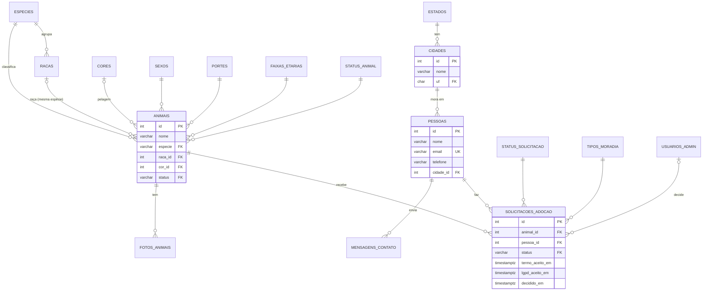
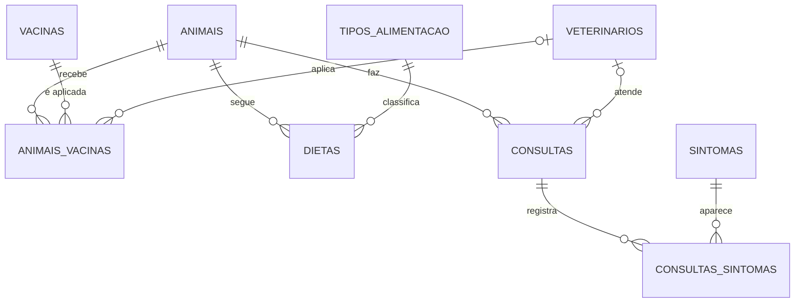

# Modelagem do banco (até a 3ª Forma Normal)

## O que estava errado no modelo anterior

| Problema | Onde | Violação |
| --- | --- | --- |
| Nome, e-mail, telefone e cidade do solicitante repetidos a cada pedido | `solicitacoes_adocao` | **3FN**: `email → nome, telefone, cidade` (dependência transitiva; a mesma pessoa podia aparecer com dados diferentes em pedidos diferentes) |
| Contato guardava nome + e-mail de novo | `mensagens_contato` | mesma dependência, em outra tabela |
| `cidade` como texto livre ("Rio do Sul", "rio do sul", "R. do Sul") | `solicitacoes_adocao` | anomalia de atualização/consistência |
| Raça digitada livre e independente da espécie (era possível "gato / Labrador") | `animais` | **3FN**: `raca → especie` |
| `cor` em texto livre | `animais` | dado repetido sem chave |
| Espécie, sexo, porte, faixa etária, status e moradia como `VARCHAR + CHECK` | várias | valores de domínio repetidos como texto, rótulos duplicados no código |
| `aceitou_termo` / `aceitou_lgpd` sempre `true` | `solicitacoes_adocao` | coluna sem informação; o que importa é **quando** aceitou |
| Várias fotos "principais" possíveis; ordem repetida | `fotos_animais` | sem restrição de unicidade |
| `decidido_em`/`motivo_recusa` livres, sem coerência com o status | `solicitacoes_adocao` | estados impossíveis (ex.: pendente com data de decisão) |

## Passo a passo

**1FN** — todos os campos são atômicos (sem listas nem grupos repetidos). Fotos já ficavam em tabela própria; continuam assim.

**2FN** — com chaves primárias simples (`id`), nenhum atributo depende de parte da chave. As tabelas de domínio usam chave simples (`codigo`).

**3FN** — nenhum atributo não-chave depende de outro atributo não-chave:

- `email → nome, telefone, cidade` ⇒ tabela **`pessoas`**; `solicitacoes_adocao` e `mensagens_contato` só guardam `pessoa_id`.
- `cidade → uf` ⇒ **`cidades`** (nome + UF) com **`estados`** (sigla → nome).
- `raca → especie` ⇒ **`racas`**; o animal referencia `(raca_id, especie)` por **FK composta**, então o banco recusa uma raça de outra espécie.
- `cor` ⇒ **`cores`**.
- Valores fixos ⇒ tabelas de domínio **`especies`, `sexos`, `portes`, `faixas_etarias`, `status_animal`, `status_solicitacao`, `tipos_moradia`** (a chave é o próprio código, ex.: `'disponivel'`, e o rótulo "Disponível" mora em um lugar só).

Atributos que dependem só da chave e por isso ficam onde estão: `tipo_moradia` e `tem_outros_animais` (situação da pessoa **naquele pedido**, pode mudar de um pedido para outro), `castrado/vacinado/vermifugado` (do animal).

## Restrições que protegem as regras de negócio

| Regra | Constraint |
| --- | --- |
| RN10 — um pedido pendente por pessoa/animal | `UNIQUE (animal_id, pessoa_id) WHERE status = 'pendente'` |
| Uma foto principal por animal | `UNIQUE (animal_id) WHERE principal` |
| Pedido pendente ⇔ sem data de decisão | `CHECK ((status = 'pendente') = (decidido_em IS NULL))` |
| Motivo de recusa só em pedido recusado | `CHECK (motivo_recusa IS NULL OR status = 'recusado')` |
| Raça compatível com a espécie | `FOREIGN KEY (raca_id, especie) REFERENCES racas (id, especie)` |
| Sem duplicar pessoa/cidade/raça/cor por maiúsculas | índices únicos em `lower(...)` |
| LGPD (RN22) | `ON DELETE CASCADE` de `pessoas` para pedidos e mensagens |

## Diagrama (DER)

## Observações

- Quando a mesma pessoa pede de novo, o sistema reaproveita o registro (pelo e-mail) e atualiza nome, telefone e cidade para os dados mais recentes. Isso é consequência de a 3FN guardar cada fato uma vez só.
- Cidade, raça e cor continuam sendo digitadas pelo usuário/admin, mas o *model* reaproveita o registro existente (sem diferenciar maiúsculas) em vez de criar duplicatas.

## Módulo de saúde (também em 3FN)

| Tabela | Para quê |
| --- | --- |
| `veterinarios` | quem atendeu (selecionado, não digitado) |
| `vacinas` | catálogo de vacinas; `especie` nula = serve para qualquer espécie |
| `animais_vacinas` | aplicação: animal, vacina, data, próxima dose, veterinário |
| `tipos_alimentacao` | domínio (ração seca/úmida, natural, mista, terapêutica) |
| `dietas` | alimentação do animal ao longo do tempo (início, fim, refeições/dia, restrições) |
| `sintomas` | catálogo do que o animal pode apresentar |
| `consultas` | data, motivo, diagnóstico, tratamento, retorno |
| `consultas_sintomas` | N:N entre consulta e sintoma (chave composta) |

Constraints: próxima dose e retorno não podem ser anteriores à data base; dieta só encerra depois de iniciar;
refeições por dia entre 1 e 12; apagar o animal apaga sua saúde (`ON DELETE CASCADE`); apagar um veterinário só
desvincula os registros (`ON DELETE SET NULL`).

